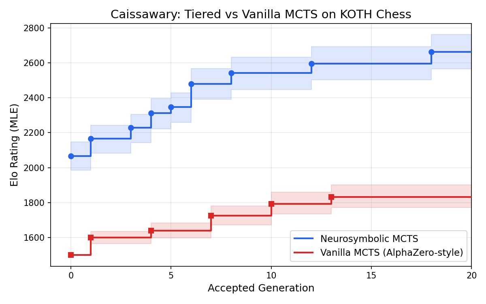

# Neurosymbolic Monte Carlo tree search

**Exact solutions for tractable positions as terminal search nodes, for sample-efficient reinforcement learning.**

Self-play engines like AlphaZero learn everything from scratch, including positions a classical
solver can evaluate exactly in microseconds. This engine searches classically first. Any position
an exact method can evaluate, such as a forced mate in N moves, becomes a terminal node of the Monte
Carlo tree search (MCTS) with its exact value, just as checkmate does, so the engine is rewarded for
reaching it rather than only for checkmate. The training signal is denser, and unlike a learned
reward model it cannot be gamed. The exact evaluation is also cheaper: an exact search costs at
most about 140 µs per position, compared with about 1,350 µs for a network evaluation as the search sees it.
Only positions no exact method can evaluate are sent to the neural network.

Where no exact answer exists, the classical search still informs the network. A quiescence search
plays out the forcing moves in a position, mainly captures, and scores the quiet position that
results. That score enters the value function twice: as a prior term added to the network's
output, and as an input to the network. Forced sequences are easy for human players and classical
engines but hard for a network that evaluates a position in a single pass. AlphaGo fed the result of
a ladder search, a forced capturing sequence in Go, to its networks as an input feature
([Silver et al., *Nature* 2016](https://doi.org/10.1038/nature16961)), and AlphaGo Zero, trained
without such features, understood ladders "only … much later in training"
([Silver et al., *Nature* 2017](https://doi.org/10.1038/nature24270)).

The pattern, exact solutions for tractable subproblems injected as terminal search nodes, applies to
any domain with classically solvable subproblems, such as mathematical reasoning with an automated
theorem prover.

## Where the project stands

- **King of the Hill** (a chess variant where reaching the center also wins): the tiered engine
  rates about 625 Elo above a network-only baseline, with caveats below that make this a
  preliminary result.
- **Standard chess**, the intended headline: a 30-generation pilot of the network-only engine with
  mate-in-one and endgame tables ran cleanly, and candidates kept beating the current model, but
  the acceptance test took only 4 of 30. The tiered engine has not yet been trained there, because
  its classical search is expensive in standard chess.
- **Self-play speed** (standard chess, 200 simulations per move): **765 moves per second** with the
  network plus the default exact endings (forced mates found by checking moves, and endgame
  tables), and 730 with the network alone, up from about 65 under LibTorch; **109** with the
  classical tiers on.
- **Mate search**: 3.7× faster at the default setting, from generating only the moves it needs,
  trying first the checks that leave the enemy king fewest escape squares, and remembering
  positions already searched; this also removed a false-mate bug.
- **Training loop**: besides generations accepted by a statistical test, the network can now be
  trained continuously while self-play runs, with no acceptance step. This works end to end but
  has not yet trained a model.

## Result in King of the Hill

Both engines were trained by self-play in King of the Hill, a variant chosen because positions
with exact solutions are common in it ([DESIGN_DECISIONS.md](DESIGN_DECISIONS.md)). Both use the
same network (6 residual blocks, 128 channels, ~2M parameters) and 200 search simulations per move;
the baseline uses the neural network alone, as AlphaZero does.

After 18 generations the tiered engine rates **2663 Elo [2565, 2763]**, and the baseline after 28
generations **2038 [1957, 2111]**.



Ratings come from 6,579 games over 17 pairings, fitted with the Bradley–Terry model, with 95%
bootstrap intervals (1,000 resamples) relative to the baseline's first generation. Three things
limit what this shows:

- **Compute is not matched.** Both engines get 200 simulations per move, but the tiered engine's
  classical search is extra computation that is not counted.
- **The two runs are joined by one 100-game match**: the tiered engine before any training (its
  network initialized to zero, so it evaluates positions classically) versus the baseline after 28
  generations, +30 Elo [−20, +74]. Each run was rated as a ladder of adjacent generations, and no
  bootstrap interval on the gap between the final models has been computed.
- **Part of the gap may be a head start**: the untrained tiered engine is already about level with
  the fully trained baseline.

A comparison in standard chess at equal wall-clock time, including the untrained tiered engine, is
the next measurement (see [next steps](#current-state-and-next-steps)).

<details>
<summary>All 18 ratings</summary>

| Model | Elo | 95% interval |
|---|---|---|
| tiered_gen18 | 2663 | [2565, 2763] |
| tiered_gen12 | 2595 | [2502, 2692] |
| tiered_gen8 | 2542 | [2448, 2633] |
| tiered_gen6 | 2478 | [2391, 2567] |
| tiered_gen5 | 2347 | [2260, 2428] |
| tiered_gen4 | 2312 | [2223, 2395] |
| tiered_gen3 | 2228 | [2144, 2306] |
| tiered_gen1 | 2167 | [2082, 2242] |
| tiered_gen0 | 2068 | [1984, 2148] |
| vanilla_gen28 | 2038 | [1957, 2111] |
| vanilla_gen23 | 1996 | [1920, 2063] |
| vanilla_gen21 | 1866 | [1801, 1933] |
| vanilla_gen13 | 1833 | [1772, 1902] |
| vanilla_gen10 | 1794 | [1734, 1859] |
| vanilla_gen7 | 1726 | [1672, 1781] |
| vanilla_gen4 | 1639 | [1598, 1684] |
| vanilla_gen1 | 1600 | [1566, 1636] |
| vanilla_gen0 | 1500 | (anchor) |

`tiered` is this engine and `vanilla` the baseline.

</details>

## How the search works

Each position is handled by the cheapest method that can evaluate it:

| Tier | Method | Result | Mean cost |
|---|---|---|---|
| 1 | Exact search for a forced mate in up to 5 moves (checking moves only), or a forced king march to the center in up to 3 | Proven value | 132–149 µs³ |
| 2 | Quiescence search: captures and promotions are played out until the position is quiet, with all replies to check, one quiet check or fork per side, and a test for threats made by letting the side to move pass; the quiet position is scored with PeSTO, a standard hand-tuned evaluation of material and piece placement | Heuristic value | 8 µs |
| 3 | Neural network | Learned value | 1,346 µs |

Costs were measured with `profile_engine` (4 games played one after another,
200 simulations per move). The Tier 3 cost is the time per network call as the search sees it,
including up to 0.5 ms that the inference server waits for other requests to fill a batch.

³ Measured before the mate search was sped up (see below), so the current cost is lower.

A position evaluated exactly in Tier 1 is terminal, like checkmate or stalemate, so its proven value
propagates up the tree without being averaged with approximate evaluations of its children.

The final value combines the network with the classical score:

$$V = \tanh(V_{\text{net}} + k \cdot \Delta M)$$

where $\Delta M$ is the Tier 2 score, $V_{\text{net}}$ is the network's unbounded output (which also
receives $\Delta M$ as an input), and $k$ is a learned scalar for how much to trust material,
initialized to 0.326. With no network, $V = \tanh(0.326 \cdot \Delta M)$; this is the untrained
engine in the result above. The baseline ("vanilla") runs with Tiers 1 and 2 off: no exact
search, and the network receives $\Delta M = 0$.

Either mode can also use two cheap exact results, so that the network does not have to learn them:

- **Forced mates.** By default, `self_play` and `evaluate_models` look for a mate in up to 5 moves
  in which every attacking move gives check. In network-only mode, a leaf where such a mate exists
  gets the value +1 (tiered search already finds these). The search answers only whether a mate
  exists, not which move mates or how fast, so it can stop at the first mating line of any length.
  It tries first the checks that leave the enemy king fewest escape squares, and for the defender
  captures of the checking piece, then blocks, then king moves, and it remembers the result for
  each position it has searched; it takes about 13 µs per position.
  Tier 1 runs the same search at leaves, to its own depth, and at the root also finds the
  mating move. `--mate-checks N` sets the depth, `--mate-in N` searches every move up to mate in N,
  `--mate-quiet M` allows M non-checking attacking moves per line, and `--no-mate-search` turns it
  off.
- **Endgame tables.** With `--syzygy <dir>`, a leaf with 5 or fewer pieces and no castling rights
  gets its value from Syzygy endgame tables (win/draw/loss tables for every such position, 396 MB).
  Wins and losses that the fifty-move rule would turn into draws count as draws. The tables are not
  used in King of the Hill, where reaching the centre changes the result.

Either kind of position also ends a self-play or evaluation game with its exact result, so no
training position of either kind is recorded. A model should be played with the settings it was
trained with; models trained before the mate search became the default need `--no-mate-search`, or
`--mate-in 1` for the standard-chess pilot.

Moves are selected with AlphaZero's rule (PUCT, a variant of the upper confidence bound for trees),
with one change:

$$U(s,a) = c \cdot P(s,a) \cdot \frac{\sqrt{\max(N(s), 1)}}{1 + n(s,a)}$$

AlphaZero uses $N(s)$, the visit count of the parent, in place of $\max(N(s), 1)$. On a node's first
visit $N = 0$, which makes the exploration bonus zero for every move, so the first move tried is
whichever the move generator lists first. With $\max(N, 1)$ the bonus is proportional to the
network's prior $P(s,a)$ from the first visit, so the network's top choice is tried first. For
$N \geq 1$ the two rules are identical.

After each move the subtree under the move played is kept for the next search. Its visits count
toward the next move's budget, so "200 simulations per move" means the root reaches 200 visits,
not that 200 new simulations run.

## How the components fit together

| Component | Language | Role |
|---|---|---|
| Search engine (`src/`) | Rust | Board representation, move generation, the three tiers, MCTS, self-play and evaluation binaries |
| Network inference (`src/nn/`) | Rust, [candle](https://github.com/huggingface/candle), cuDNN, CUDA | Runs the network on CPU or GPU, called from batching threads that collect requests from all search threads |
| Training (`python/`) | Python, PyTorch | Defines the network, trains it on self-play data, and runs the loop in generations (`orchestrate.py`) or continuously (`continuous.py`) |
| GPU search (`cuda/`) | CUDA C++ | An alternative in which the entire search runs on the GPU (see below) |

The network is trained in PyTorch and run in Rust. The Python side calls the Rust binaries for
self-play and evaluation, and they write training positions to disk for the Python trainer. The
Rust side re-implements the network layer by layer and loads the PyTorch weights file (`.pth` or
`.safetensors`) directly, so a trained model needs no export step. A committed set of PyTorch
reference outputs, from a small network with every weight randomized, checks that the two
implementations agree to within 1e-4.

The search runs in Rust because a Tier 1 search visits about 1,000 positions per call, which
needs bit-level board operations with no interpreter overhead. Each game runs on its own search
thread (1,920 by default), and their network requests are collected into batches: in f16 a call on 128 positions takes 13 µs per
position, compared with 29 µs per position for a batch of 32.

**Why candle instead of LibTorch.** The engine first ran the network through LibTorch, PyTorch's C++
library, via the `tch` bindings. Candle, a machine learning library written in Rust, removed that
dependency and its run-time CUDA library setup, lets the network tests run in continuous integration
on CPU, and allows custom CUDA kernels and cuDNN calls next to the network code. With batch
normalization folded into the convolutions at load time and the cuDNN algorithm fixed per batch
size, a batch of 128 took 4.40 ms in candle and 7.19 ms in LibTorch (f32, before any of the changes
below).

**Precision.** In builds with cuDNN, the network runs on the GPU in 16-bit floating point (f16) on
the tensor cores, accumulating in 32 bits; `KF_PRECISION=f32` (or `bf16`) overrides this, and the CPU
always uses f32. On the generation-34 model, f16 changes move priors by
at most 0.004 and the value logit by at most 0.023, and picks the top move of f32 on 64 of 64 test
positions. Time per call through `predict_batch` (`nn_bench`, median of 500 calls; interquartile
ranges within 1.5% of the median):

| Batch size | f32 | f16 |
|---|---|---|
| 32 | 1.74 ms | 0.93 ms |
| 64 | 2.30 ms | 1.07 ms |
| 128 | 3.25 ms | 1.72 ms |

## Self-play throughput

Self-play speed decides how much training data each hour of compute buys. It is measured in
standard chess with a randomly initialized network and the classical tiers off, so that every run
does the same work per move and only speed differs. All runs use 200 simulations per move, an RTX
5060 Ti and a 16-core Ryzen 9 7950X, with one game per search thread.

The network alone makes **730 moves per second** (729.8 ± 0.7) with the defaults of `self_play`
and `orchestrate.py`: f16, CUDA graphs, four batching threads serving 1,920 search threads, batch
cap 128, built with `--features cudnn`. With the default mate search and endgame tables it makes
**765** (764.5 ± 0.7):

```bash
./target/release/self_play 1920 200 out/ model.pt false false false none --syzygy /data/syzygy
```

### From 65 to 765 moves per second

Changes in the order they were made. Each gain comes from before-and-after runs of that change
alone. The first five were measured with fewer threads, so moves per second is given only from
the fourth batching thread on, when the final setting (1,920 search threads, cap 128) was reached.
After that, ± is half the difference between two runs, and rows without it are single runs.
Rows marked ¹ change the search's work per move, so their gain is not a pure speed-up.

| Change | Gain | Moves/s |
|---|---|---|
| LibTorch, the starting point | | about 65 |
| **Candle with cuDNN** (described above) | network call 39% faster | |
| **Fused kernels** for bias, ReLU and squeeze-and-excitation | +19% | |
| **Priors for legal moves only**, gathered on the GPU | +26% | |
| **f16 on tensor cores** instead of f32 | +58% | |
| **mimalloc** instead of glibc's allocator (measured in f32) | +35% | |
| **Four batching threads** and 1,920 search threads, from one and 480 | +52% | 453 (mean of 5) |
| **One cuDNN call for convolution, bias and ReLU** | +1% | 442 |
| **Channels-last activations** throughout | +7% | 474 |
| **CUDA graphs**: each batch replays a recorded forward pass | +13% | 534.3 ± 0.3 |
| **Two-byte moves** | +4% | 560.1 ± 1.3 |
| **Reused subtree counts toward the budget**¹ | +10% | 615.9 ± 1.6 |
| **No root quiescence search in vanilla self-play** | +18% | 730.2 ± 0.3 |
| **f16 and CUDA graphs as defaults**, rather than set by environment variables | none | 729.8 ± 0.7 |
| **Mate in one at leaves**¹ | +13% | 824.1 ± 0.6 |
| **Endgame tables at leaves**, ending games at a covered position | none | 823.4 ± 0.1 |
| **Games end at a mate in one**¹, as at a covered position | −10% | 742.2 ± 3.7 |
| **Mates in up to 5 by checking moves**¹ (the default) | +3% | 763.4 ± 0.5 |
| **Faster mate search** ([below](#speeding-up-the-mate-search)) | none | 764.5 ± 0.7 |

- **The 65 moves per second was not recorded** in this repository, and its settings (game, threads,
  tiers) are not confirmed to match the later rows.
- **Moves per second sometimes falls between rows** (453 → 442) because rebuilding the earlier
  commit measured 437; see "Unexplained" below.
- **Candle and fused kernels.** Candle's generic broadcast kernels for bias, ReLU and
  squeeze-and-excitation took about 40% of GPU time, 18–30 µs each on tensors that need about 2 µs.
  Three custom CUDA kernels, compiled when the model loads, do each in one pass and match the unfused
  operations to 1e-5.
- **Legal-move priors.** The policy head scores all 4,672 possible moves; copying only the legal
  moves' logits back cuts the transfer from 0.36 ms to 0.04 ms per batch.
- **f16.** Candle's own half-precision convolution rebuilt its cuDNN setup on every call and
  accumulated in 16 bits, which cuDNN serves with slow kernels; a small wrapper
  (`src/nn/cudnn_conv.rs`) keeps the setup for each batch size and accumulates in 32 bits.
- **mimalloc.** With hundreds of search threads, glibc's allocator spent most of its time on shared
  locks; mimalloc keeps a separate heap per thread.
- **Several batching threads.** A batch of about 120 positions launches too few thread blocks to
  fill the GPU. Each batching thread has its own copy of the network on its own CUDA stream, so
  kernels from different batches overlap. With CUDA graphs on, 2 batching threads give 457 and 3
  give 520, compared with 534 for 4; 6 threads and 2,880 search threads are no faster.
- **Channels-last and fused convolution.** cuDNN's tensor-core kernels work in channels-last
  (NHWC) layout, so with the network in channels-first layout cuDNN converted every convolution's
  input and output, 15% of kernel time. Fusing bias and ReLU into the convolution alone gained
  little because it added layout conversions; keeping activations channels-last removed them.
- **CUDA graphs.** An eager forward pass launches about 120 kernels and makes about 160 GPU
  allocations, each launch taking ~9 µs in the driver with four batching threads. A recorded graph
  replays the pass with one launch; batches are padded to a few sizes, each with its own graph. The
  batching thread's launch time per batch fell from 2,715 µs to 438 µs.
- **Two-byte moves.** A move was a 32-byte struct; packed into 16 bits (6 bits per square, 4 for
  the promotion piece, as Stockfish does) it shrinks move lists and search nodes and cut search CPU
  time 8.8%. With tiers on, the gain was +9.6%.
- **Reuse budget.** Previously each move ran 200 new simulations on top of the reused subtree. This
  changes the search's work per move by design; with tiers on, network evaluations per move fell 36%
  and throughput rose from 68.9 to 109.7.
- **Root quiescence search.** Self-play ran a full quiescence search at the root of every move to
  record the network's material input, even in vanilla mode, where training sets that input to zero.
  On positions from games between random networks it took more than half of the search threads' CPU
  time, sometimes seconds for one position. Skipping it cut CPU time per move from 34.3 ms to
  15.6 ms.
- **Defaults.** Making f16 and graphs the defaults played identical games (234,831 moves) and
  changed nothing in speed. It exposed a crash: creating a CUDA stream or cuDNN handle on one
  thread invalidated a graph being recorded on another, so these steps now share one lock.
- **Mate in one.** A leaf whose side to move can mate in one gets the value +1 without a network
  call. Network evaluations per move fell from 46.7 to 41.1, and the mean game from 134 to 122
  moves. The check costs about one move generation per leaf on the CPU, which has spare time
  while the GPU is the bottleneck.
- **Endgame tables.** Probes are needed only at 5 or fewer pieces, so they add no measurable cost;
  22% of games (430 of 1,920) ended at a covered position.
- **Ending games at a mate in one.** The move that mates, and the replies before it, cost almost
  no network calls, so removing them from the count lowers moves per second: network evaluations
  per move rose from 40.7 to 44.6. The rate falls because cheap moves are no longer played, not
  because any move got slower.
- **Mates in up to 5.** A deeper search ends more games early (82% of games end at a forced mate,
  compared with 72% for mate in one) and saves network calls (41.9 per move, compared with 44.3),
  for 3 ms more CPU time per move on cores that were idle. See the sweep below.
- **Faster mate search.** At mate in 5 the GPU is the bottleneck, so the faster search changed
  nothing (764.9 ± 2.5 before, in the same session); it matters at deeper settings.
- **Unexplained.** Rebuilding the move-generation change that preceded the fused convolution
  measured 437 instead of 453 moves per second (two runs each); the cause was not found.

### What limits it now

With the network alone, the GPU is busy 92–93% of the time. Profiled before exact endings were added,
each batch spent 1.4 ms waiting for the GPU and about 1 ms in other driver calls: creating and
destroying an event (0.3 ms), four uploads from pageable host memory (0.29 ms), two downloads
(0.2 ms) and six allocations (0.15 ms). Reserving room for 256 moves in each move list
(`KF_RESERVE_MOVES=1`) gave a further +4.5% with two-byte moves, but has not been measured on the
current code.

With the tiers on, self-play is limited by the CPU: 109.0–110.3 moves per second with 480 search
threads and one batching thread, the GPU busy 14% of the time. Nearly all of that CPU time goes to
the classical search's move handling.

### How deep to search for mates

Each setting ran 1,920 games with endgame tables on, two runs alternated (± is half their
difference), except the last six rows, which are single runs. The settings play different games,
so moves per second compares the cost per training position rather than equal work. The untrained
network blunders into mates far more often than a trained one would, so the savings in training
are likely smaller. All rows predate the mate search speed-ups below.

| Mate search | Moves/s | Network calls per move | CPU ms per move | Games ending at a mate |
|---|---|---|---|---|
| Mate in 1 | 742.2 ± 3.7 | 44.3 | 15.7 | 72% |
| Every move, mate in 2 | 732.7 ± 1.4 | 43.2 | 25.2 | 80% |
| Every move, mate in 3 | 124.2 ± 0.2 | 42.7 | 241 | 84% |
| Checking moves, mate in 2 | 748.3 ± 0.2 | 43.1 | 16.4 | 77% |
| Checking moves, mate in 3 | 754.0 ± 0.6 | 42.5 | 16.6 | 80% |
| Checking moves, mate in 4 | 760.1 ± 0.7 | 42.1 | 17.3 | 82% |
| **Checking moves, mate in 5** | **763.4 ± 0.5** | 41.9 | 18.5 | 82% |
| Checking moves, mate in 6 | 765.6 | 41.5 | 22.1 | 83% |
| Checking moves, mate in 7 | 640.3 | 41.3 | 35.6 | 85% |
| Checking moves, mate in 8 | 305.2 | 41.4 | 87.3 | 84% |
| Checking moves, mate in 3, one quiet move per line | 672.7 | 42.5 | 33.6 | 83% |
| Checking moves, mate in 4, one quiet move per line | 478.5 | 42.0 | 54.9 | 85% |
| Checking moves, mate in 5, one quiet move per line | 250.2 | 41.9 | 115.9 | 87% |

Once the mate search uses more CPU time than the cores have spare, the network waits on it and
throughput collapses: searching every move to mate in 3 leaves the GPU busy 19% of the time.
Mate in 6 is within noise of mate in 5 (the gap between two identical settings was 0.4%) at 19%
more CPU time, so mate in 5 is the default. The sweep was stopped to speed up the search first,
and will be rerun with the faster code.

### Speeding up the mate search

The mate search is timed on one thread by `mate_bench`, using 20,000 positions from the pilot's
logged evaluation games (generations 20–29), each extended by 1–3 random moves to imitate search
leaves. The answer for every position must stay the same after each change, checked by a checksum
in the benchmark and by a test that compares the search with a slow reference solver on 300 of
these positions. Times are µs per position, means of 5 runs (standard deviation under 0.4%;
rebuilding identical code shifts them by about 1%).

| Change | Checks, mate in 5 | Checks, mate in 6 | Checks, mate in 3, one quiet move | Every move, mate in 2 |
|---|---|---|---|---|
| Start | 44.7 | 151.6 | 78.7 | 29.0 |
| **Move lists reused**, one per ply, instead of allocated at each position | 37.6 | 127.8 | 63.6 | 25.7 |
| **Checking moves generated directly** | 22.9 | 81.9 | 32.2 | 26.1 |
| **Only moves out of check generated**, and the checkmate test stops at the first legal one | 18.4 | 70.2 | 28.1 | 25.9 |
| **Checking moves tried in order of the enemy king's escape squares**² | 16.0 | 56.0 | 28.7 | 25.9 |
| **Positions already searched remembered** (a transposition table)² | 12.0 | 32.0 | 28.1 | 26.0 |
| Total speed-up | 3.7× | 4.7× | 2.8× | 1.1× |

² Absolute times drifted between later runs by more than their standard deviation (up to 16% for
mate in 6), so these rows apply the change measured within one run to the row above: −12.8%,
−20.2%, +2.1% and +0.1% for the move order, and −25.2%, −42.9%, −2.2% and +0.5% for the table
(which includes the defender's captures by its most valuable piece first, −0.1% to −0.5%).

- **Checking moves.** In a checks-only search the attacker plays only checks, about 3 of a
  position's 35 moves, but the search generated all of them and tested each with `gives_check`
  (23% of the time). Direct checks now come from intersecting each piece's reachable squares with
  the squares from which that piece would attack the enemy king. Moves that could uncover a check,
  promotions, en passant and castling are rare and are still tested one by one, so the generated
  set is exactly the one filtering gave.
- **Moves out of check.** A defender in check can only move the king, capture the checking piece or
  block it. Generating only these replaced generating every move and testing each for legality.
  Their order matters: listing king moves first made the search visit 5× more positions, because
  captures of the checking piece refute most mating attempts soonest; captures, then blocks, then
  king moves restored it.
- **A false mate.** The old checkmate test treated an enemy pawn diagonally behind the king as a
  second checker and declared mate without trying blocks or captures. It reported a mate in 2 that
  does not exist in 1 of the 20,000 positions; tier 1 used the same code.
- **Searches over every move** gained little: their time goes to making moves and testing their
  legality, which these changes do not touch.

**Move order.** The search stops at the first mate at the attacker's move and at the first
refutation at the defender's, so the order of moves changes how many positions it visits but never
its answer. 77 pairs of an attacker and a defender order were compared on half of the 20,000
positions, all giving identical answers, and the best checked on the other half:

| Attacker order, defender order | Positions searched, mate in 5 | Time, mate in 5 | Time, mate in 6 |
|---|---|---|---|
| As generated (pieces in a fixed order), as generated (captures, blocks, king moves) | | 18.9 µs | 72.2 µs |
| As generated, captures, promotions, blocks, king moves | +0.0% | +8.6% | +8.0% |
| Double checks, captures, promotions, queen moves closest to the king, knight moves, the rest closest first; captures, promotions, blocks, king moves | −5.6% | +27.0% | +28.5% |
| Farthest from the king first, as generated | +13.0% | +43.5% | +56.4% |
| As generated, king moves first | +581% | +595% | +1,087% |
| Fewest king escape squares after the move (move made), as generated | −36.8% | +25.5% | +7.1% |
| Fewest escape squares, estimated without making the move, as generated | −19.6% | −2.3% | −8.9% |
| **As above for checking moves only, not on the attacker's last move**, as generated | **−19.0%** | **−13.4%** | **−19.8%** |
| The same, on the held-out half | −17.2% | −12.1% | −18.5% |

Differences are relative to the first row, from runs on the same half (5 runs each, standard
deviations under 0.2%).

- **Computing an order costs more than most orders save.** Sorting alone, with no change in the
  positions searched, cost 8.6%, and every order built from move types (double checks, captures,
  piece, distance to the king) took longer than generated order.
- **What pays is the king's escape squares**: a mating attempt that leaves the enemy king fewer
  squares to run to is more likely to mate. Counting them by making each move halved the positions
  searched at mate in 6 but doubled the cost per position. An estimate from one map of the
  squares the attacker controls, plus the moved piece's attacks from its new square, keeps most of
  the saving at a fraction of the cost.
- **Order matters only where a search stops early.** On the attacker's last move every checking
  move is tried unless one mates, so sorting there cost more than it saved; dropping it turned
  −2.3% into −13.4%. With a quiet move per line or every move searched, lists are long and stop
  rarely, so they stay as generated.
- **The defender's generated order was beaten only slightly**: captures of the checking piece,
  then blocks, then king moves, with captures by the most valuable piece first (rather than pawns
  first) 0.2–0.6% faster.
- **Orders in which moves are generated** cost nothing, but none of 72 combinations helped beyond
  that: generating queen checks first was 1.5–2.3% slower at mate in 5, capturing checks first
  10–11% slower, and sorting only queen checks by escape squares 11% slower than sorting every
  check.
- **Trying first the move that ended the previous sibling's search** (the killer heuristic, common
  in chess engines) was 44% slower at mate in 5: it overrides the escape-square and
  captures-first orders, which were already better.

**Remembering positions.** Checking lines revisit positions often: a check, a king step and a
check back return to an earlier position, and different orders of the same checks meet. The
search now keeps, for the duration of one search, the result for each position it has searched
with at least two moves left: 16,384 entries of 16 bytes (256 KB) per search thread, replaced on
collision. A mate found with fewer moves left also answers a search with more, and no mate with
more moves left answers one with fewer. This cut positions searched at mate in 5 by 33% and time
by 25%; at mate in 7 time fell 59%. On positions where a quiet move is allowed or every move is
searched, it gained 0–2%.

**Benchmark positions.** The positions above extend logged games by random moves. To check that
they represent what the search actually sees, `self_play` can log every Nth position at which it
searches a leaf for mates (`KF_LOG_MATE_LEAVES=<file>:<N>`), with its game. 20,000 positions
sampled from 1,920 games of the generation-28 model, split into halves by game, ranked the 72
generation orders almost exactly as the old positions did (Spearman correlation 0.995 at mate in
5). On the half not used for tuning, the table cut time by 26.6% at mate in 5, 44.6% at mate in
6 and 64.2% at mate in 7.

**In self-play**, with endgame tables on and two runs each (± half their difference), the faster
search makes no difference at the default mate in 5, where the GPU is the bottleneck: 764.5 ± 0.7
moves per second, compared with 764.9 ± 2.5. At mate in 7, where the old search ran the CPU out
of spare time, it raises throughput 18%, from 643.3 ± 0.6 to 760.0 ± 0.3, and cuts CPU time per
move from 35.6 to 21.5 ms. Adding the table left mate in 5 unchanged (761.8 ± 0.9, compared
with 762.4 ± 1.4) and raised mate in 7 from 759.3 ± 0.6 to 767.8 ± 0.7, now 0.8% faster than mate
in 5; CPU time per move at mate in 7 fell from 21.4 to 19.8 ms. Deeper mate searches are now
nearly free, which the rerun of the depth sweep will measure.

Changes measured and not adopted:

- **Several leaves per game (optional, off by default).** Each game selects K leaves before waiting
  for the network, with a temporary "virtual loss" steering later selections elsewhere. In King of
  the Hill, K = 4 raised throughput 58% at 60 threads, but at equal simulations it plays weaker: in
  200 games of the generation-34 model playing itself, K = 4 scored 0.435, or −45 Elo [−92, +2]
  relative to K = 1 (`--leaves-per-game`). More threads raise batch sizes without this cost.
- **Collecting the next batch while the GPU runs the current one** (on by default, `KF_PIPELINE=0`
  turns it off): 298.0 compared with 310.0 with one batching thread, and 453.1 compared with 456.9
  with four.
- **Reserving CPU cores for the batching thread** (`KF_INFER_CPUS`). With the tiers off, the thread
  waited for a free core only 1–5% of the time, which bounds what reserving cores can gain.
- **A shorter wait for a batch to fill.** An idle batching thread waits up to 500 µs for more
  requests; 0 µs gave 244 moves per second and 2,000 µs gave 287, compared with 298.
- **Larger batches from one batching thread:** 326 moves per second at cap 256 with 960 threads,
  and 334 and 329 at cap 512 with 1,920, compared with 453 for four threads at cap 128.

## Training

Two loops are available. Both train on positions from self-play, with a policy target (the
search's visit counts) and a value target (the game's result).

**In generations** (`orchestrate.py`), as in AlphaGo Zero: self-play with the current model, train
a candidate on a replay buffer, and accept the candidate only if it beats the current model.

- **Optimizer:** Muon (learning rate 0.02), with adaptive epochs and early stopping. It has not yet
  been compared with AdamW.
- **Accepting a new generation:** a sequential probability ratio test (SPRT) over up to 800
  evaluation games by default (200 in the pilot), which stops early when the result is clear.
- **Data:** after generation 1 the evaluation games also supply training data, so separate self-play
  is optional. Positions are weighted by the strength of the model that played them (a 200-Elo gap
  gives about 32% inclusion).

**Continuously** (`continuous.py`), as in AlphaZero and KataGo: one network, updated while
self-play runs, with no acceptance step.

- **Self-play** keeps a fixed number of games going (`--concurrent-games`). Each new game loads the
  newest weights the trainer has published (`self_play --watch <pointer file>`), so a game never
  mixes two networks. Game files are written under a temporary name and renamed when complete, and
  their names record the weights version.
- **The trainer** moves finished games into a sliding window of recent positions (`--window`) and
  trains so that each generated position is used `--replay-ratio` times on average. It publishes
  weights every `--publish-every` steps.
- **If training falls behind** by more than `--max-owed` steps, self-play is paused until it
  catches up, so the replay ratio holds whatever the relative speeds of the two.
- **Logged at each publish:** losses, positions and games so far, how many versions old the
  finished games' weights were, and the time self-play spent paused.
- **A 9-minute check** (fresh network, 32 games at a time, 100 simulations per move, replay ratio
  4): 388 games were played with weights versions 0 to 11, each version loaded once, and training
  kept up without pausing self-play.
- **Batches stay on one network** because each version has its own inference server; while games
  started on an older version finish, the games in flight are split across servers, so batches
  are smaller. This has not been measured.

**Board symmetries**, in both loops: a position without castling rights is equivalent to its
mirror image, and a pawnless one to all eight rotations and reflections of the board. Each sampled
position is trained on one of its equivalent images, drawn at random, so every position counts
once whatever its symmetry and repeated draws see different images. Adding every image instead
would count a pawnless ending eight times as often as a position with castling rights.

```bash
python python/orchestrate.py --enable-koth \
  --sims-schedule "0:100,5:200,10:400,20:800"    # full training loop, King of the Hill
python python/orchestrate.py --disable-tier1       # ablation: no exact search
python python/orchestrate.py --disable-material    # ablation: no classical material score
python python/orchestrate.py --skip-self-play      # train on evaluation games only
python python/orchestrate.py --disable-tier1 --disable-material \
  --syzygy-path /data/syzygy                       # network only, plus forced mates and endgame tables
python python/orchestrate.py --mate-checks 0       # no mate search (--mate-in N, --mate-quiet M also exist)
python python/orchestrate.py --arch transformer --enable-koth
python python/continuous.py --work-dir runs/c1 \
  --replay-ratio 4 --window 200000                 # continuous training; every setting is a flag
```

## Search on the GPU

The `cuda/` folder holds a version in which the whole search runs inside one persistent CUDA kernel:
tree traversal, node expansion, the tactical checks, quiescence search and the network itself, with
no round trips to the CPU and no cuBLAS or cuDNN. On an RTX 5060 Ti with 36 concurrent games at 200
simulations per move it produces 101.4 training samples per second (20,300 simulations per second).
It is limited by the GPU's ~99 KB of shared memory per multiprocessor, which caps the network size,
so current work runs the search on CPU threads and batches network evaluations on the GPU. Design
details and measurements: [BENCHMARKS.md](BENCHMARKS.md) and [CUDA_TC_ANALYSIS.md](CUDA_TC_ANALYSIS.md).

## Current state and next steps

The engine, training loop and both search back ends work. In standard chess, a pilot of the
network-only engine with mate-in-one and endgame tables (30 generations of 400 self-play games,
about 3.5 minutes each, evaluation capped at 200 games) ran without errors, but only generations
1, 2, 9 and 28 were accepted. The 26 rejected candidates scored a median of 0.60 (range
0.50–0.65) versus the current model, about +70 Elo, yet the test ended at the 200-game cap before
reaching its acceptance threshold, and an unfinished test counts as a rejection. Whether exact
endings help training is not yet measured: there is no matched run without them.

The tiered engine has not been trained in standard chess yet. Positions with exact solutions are
rarer there and the classical search is expensive: with the
generation-34 model and 60 threads, quiescence search takes 56% of search-thread time, waiting for
the network 42%, and mate search 1%. Quiescence search itself runs at 1.27 million positions per
second per thread, but averages 11,931 positions and 9.4 ms per call, mostly from a few positions
with exposed kings where checks and their evasions multiply the tree. Capping it at 2,000 positions
makes it 16× faster on 6,375 logged positions, but changes the score by at least one pawn in 11% of
them.

Next, in order:

1. **Rerun the mate depth sweep with the faster search**, and measure the faster mate search in
   tiered self-play, which is limited by the CPU.
2. **Train continuously in standard chess**: the pilot above rejected most improvements of about
   +70 Elo, and AlphaZero kept a single, continually updated network with no acceptance step
   ([Silver et al., 2017](https://arxiv.org/abs/1712.01815)). Compare the continuous loop with
   the generation loop at equal compute, add a periodic match with a fixed reference to catch a
   collapse, and log batch sizes to see whether switching weights only between games costs
   throughput.
3. **Network alone, with and without exact endings**: matched runs from scratch on one rating
   ladder, with a bootstrap interval on the Elo difference.
4. **Prune quiescence search**: discard captures that lose material by static exchange evaluation,
   skip captures that cannot raise the score enough to matter (delta pruning), search checks only on
   its first ply, cache results in a transposition table, and cap its size. The aim is a tree at
   least 10× smaller with fewer than 2% of positions changing by a pawn or more.
5. **Tiers versus network alone in standard chess at equal wall-clock time**: two runs from scratch
   on one rating ladder, with a bootstrap interval on the Elo difference, including the untrained
   tiered engine to separate a head start from better learning.
6. **Full searches on only some moves** (playout cap randomization,
   [Wu, 2019](https://arxiv.org/abs/1902.10565)): train only on moves that got a full search, and play
   the rest with a cheap one. This needs a training comparison, not just a throughput one.
7. **Per-batch driver calls**: remove the remaining ones (reuse one event, pinned host buffers, the
   gather inside the graph). With the GPU about 93% busy, this can gain at most about 7%.

Later directions:

- **A learned evaluation inside quiescence search**, a small network updated incrementally as moves
  are made, as in Stockfish's NNUE, trained on this project's own self-play data.
- **Shallow alpha-beta search (depth 2–4) at leaves**, judged only at equal wall-clock time.
- **Exact search on spare CPU cores** in network-only mode: run mate and quiescence search on newly
  expanded nodes in parallel with network evaluation, and correct the tree when an exact result
  arrives.
- **Training settings**: Muon versus AdamW, and the replay ratio and window size of continuous
  training. Architecture and learning rate can be tuned cheaply by supervised training on a saved
  buffer; simulations per move and the replay ratio need short training runs compared at equal
  GPU time.
- **Networks built around piece moves**: layers that pass information between squares a knight or
  queen move apart, rather than only between neighbours as a 3×3 convolution does.
- **Other domains**: this tiered search for problems with classically solvable subproblems, such as
  theorem proving.

## Building and running

```bash
curl --proto '=https' --tlsv1.2 -sSf https://sh.rustup.rs | sh
pip install torch numpy python-chess

cargo build --release                      # search without the network
cargo build --release --features neural    # with the network, on CPU (candle)
cargo build --release --features cuda      # with the network on the GPU (needs nvcc >= 12.8 for RTX 50-series)
cargo build --release --features cudnn     # as cuda, with cuDNN convolutions (fastest; libcudnn.so on LIBRARY_PATH)
./target/release/caissawary                # the engine, speaking the Universal Chess Interface (UCI)

# Inference settings, read from the environment by self_play and evaluate_models
KF_PRECISION=f32        # f16 (default on CUDA with cudnn), f32 (default otherwise) or bf16
KF_CUDA_GRAPHS=0        # turn off replaying each half-precision batch as a recorded CUDA graph
KF_PIPELINE=0           # launch a batch only after the previous one returns
KF_FULL_POLICY=1        # read back the full policy and compute legal-move priors on the CPU
KF_INFER_CPUS=0,16      # pin the batching thread to these CPUs, and search threads to the others
KF_RESERVE_MOVES=1      # start each move list with room for 256 moves
KF_LOG_MATE_LEAVES=f:N  # self_play: write every Nth position searched for mates to file f
# self_play flags: --batch-size N (cap, default 128), --inference-workers N (batching threads,
# default 4), --threads N (default: one per game), --syzygy DIR, --mate-checks N (default 5),
# --mate-in N, --mate-quiet M, --no-mate-search (the last five also in evaluate_models),
# --watch FILE (start each game with the newest weights named in FILE, for continuous training)
./target/release/mate_bench positions.fen 5 5,0,0 2,2,0   # time the mate search: depth,every-move depth,quiet moves
./target/release/mate_bench positions.fen 5 --orders all --half tune   # compare move orders on half the positions

cd cuda && mkdir -p build && cd build && cmake .. -DCMAKE_CUDA_ARCHITECTURES=89 && make
```

## Testing

About 1,400 tests: about 900 in Rust, 314 in CUDA and 237 in Python. The fast `cargo test` suite takes
about 50 s. See [TESTING.md](TESTING.md).

```bash
cargo test                                        # fast Rust tests (~50 s)
cargo test --features neural                      # plus the network, compared with PyTorch reference outputs
cargo test --features cudnn --test unit_tests     # plus cuDNN and channels-last tests
cargo test --features cudnn --test cuda_graph_tests  # CUDA graph replay, in a process of its own
cargo test --features slow-tests                  # full suite, including move-generation counts (~200 s)
cd python && python -m pytest test_*.py -v        # training pipeline
cuda/build/test_mcts_kernel                       # GPU search
cuda/build/test_transformer
cuda/build/test_block_ops
cuda/build/test_budget_reuse
cuda/build/test_nn_ops
cuda/build/bench_throughput 100 200 36 [p2]       # end-to-end self-play throughput
cuda/build/bench_forward_b2 1000                  # batched convolution microbenchmark
cargo test --release --features cudnn --test nn_bench -- --ignored --nocapture   # network latency by batch size
```

<details>
<summary>Binary targets</summary>

| Binary | Description |
|--------|-------------|
| `caissawary` | The engine (UCI) |
| `self_play` | Self-play data generation with game logs |
| `evaluate_models` | Head-to-head model evaluation with SPRT |
| `round_robin` | Tournament with Elo estimation |
| `mcts_inspector` | Search tree visualization (Graphviz DOT) |
| `verbose_search` | Real-time search narration |
| `verbose_game` | Full game between two classical engines |
| `benchmark` | Performance testing |
| `strength_test` | Engine strength assessment |
| `run_experiments` | Ablation studies |
| `elo_tournament` | Elo estimation for classical engines |
| `texel_tune` | Evaluation weight tuning |
| `generate_training_data` | Standalone training data generation |
| `play_engine` | Play the engine yourself |
| `profile_engine` | Per-operation timing profiler |
| `qsearch_gui` | Interactive quiescence-search tree viewer (web UI at localhost:8088) |

</details>

## Further reading

- [DESIGN_DECISIONS.md](DESIGN_DECISIONS.md): what was tried, what failed, and why
- [BENCHMARKS.md](BENCHMARKS.md): throughput measurements and the GPU design
- [TESTING.md](TESTING.md): test suite documentation and coverage
- [SPRT_GUIDE.md](SPRT_GUIDE.md): how new generations are evaluated
- [CUDA_TC_ANALYSIS.md](CUDA_TC_ANALYSIS.md): Tensor Core memory analysis

## License

MIT. See [LICENSE](LICENSE).
