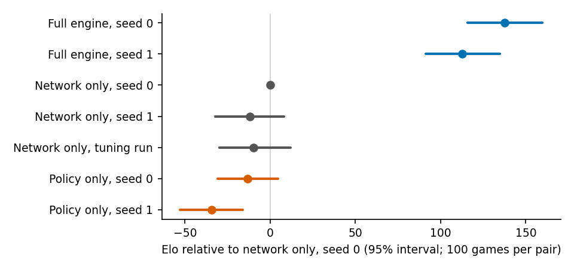

# Neurosymbolic Monte Carlo tree search

**Exact solutions for tractable positions as terminal search nodes, for sample-efficient reinforcement learning.**

Self-play engines like AlphaZero learn everything from scratch, including positions a classical
solver can evaluate exactly in microseconds. This chess engine searches classically first. Any
position an exact method can evaluate, such as a forced mate in N moves or an endgame with five
pieces or fewer, becomes a terminal node of the Monte Carlo tree search (MCTS) with its exact value,
just as checkmate does. The engine is then rewarded for reaching such a position, not only for
checkmate, so the training signal is denser, and unlike a learned reward model it cannot be gamed.

Where no exact answer exists, a quiescence search plays out the forcing moves (mainly captures)
and scores the quiet position that results; that score is added to the network's value. Forced
sequences are easy for classical search but hard for a network that evaluates a position in one
pass: AlphaGo fed the result of a ladder search to its networks
([Silver et al., *Nature* 2016](https://doi.org/10.1038/nature16961)), and AlphaGo Zero, trained
without it, understood ladders "only … much later in training"
([Silver et al., *Nature* 2017](https://doi.org/10.1038/nature24270)). The idea applies to any
domain with classically solvable subproblems, such as mathematical reasoning with an automated
theorem prover as the exact method.

**Main result so far:** trained from scratch for one hour with identical settings, this engine
rates 131 Elo [116, 146] above an AlphaZero-style engine that relies on the network alone.



## How the search works

Each position is evaluated by the cheapest method that can evaluate it (costs per position, one
CPU thread for Tiers 1 and 2):

| Tier | Method | Result | Cost |
|---|---|---|---|
| 1 | Forced mate in up to 5 moves where every attacking move gives check; endgame tables (Syzygy) for 5 or fewer pieces | Exact win, loss or draw | 12 µs (mate search) |
| 2 | Quiescence search: captures, promotions, replies to check and one quiet check or fork per side, scored with a standard hand-tuned evaluation (PeSTO) | Heuristic score ΔM | 88 µs mean, 14 µs median |
| 3 | Neural network (6 residual blocks, about 2M parameters) | Learned value and move priors | 13 µs of GPU time in a batch of 128 |

A position solved in Tier 1 is terminal, so its exact value propagates up the tree without being
averaged with approximate values. Otherwise the value is

$$V = \tanh(V_{\text{net}} + k \cdot \Delta M)$$

where $V_{\text{net}}$ is the network's unbounded output and $k$ a learned weight on the classical
score. With no network, $V = \tanh(0.326 \cdot \Delta M)$, so the untrained engine already plays
reasonably.

Three engines are compared:

- **Network only** (the baseline, as in AlphaZero): $V = \tanh(V_{\text{net}})$; forced mates and
  endgame tables still end games with their exact result.
- **Full engine**: all three tiers, with the value above.
- **Policy-only engine**: Tiers 1 and 2 give the value, $V = \tanh(0.326 \cdot \Delta M)$, and the
  network learns only which moves to search.

Moves are chosen with AlphaZero's rule (PUCT: a move's average value plus a bonus that grows with
the network's prior and shrinks with visits), except that every capture, check and fork, and every
root move, gets one visit first, so the search cannot ignore moves the network rates low. Details:
[docs/SEARCH.md](docs/SEARCH.md).

## Results

All in standard chess, on one RTX 5060 Ti GPU and a 16-core Ryzen 9 7950X CPU.

**Matched comparison.** Each engine trained from scratch for one hour with the same settings (the
best found for the network-only engine), two seeds each; then all engines played a round robin
(100 games per pair, 100 simulations per move, each searching as it was trained). Differences of
the two-seed means, with 95% intervals from resampling games:

| Comparison | Elo difference | Positions generated in the hour |
|---|---|---|
| Full engine − network only | +131 [+116, +146] | 7.0M and 7.1M, compared with 7.5M and 7.6M |
| Policy-only − network only | −18 [−29, −6] | 20.9M and 22.5M |
| Full engine − policy-only | +149 [+135, +163] | |

- The seeds of each engine differed by 12–25 Elo: much less than the full engine's lead, about as
  much as the policy-only engine's deficit.
- The policy-only engine trains on three times as much data, since it needs about a sixth of the network
  calls, and still does not catch up at this budget.
- Not yet ruled out: part of the lead may be a head start from the classical score, and the matches
  fixed simulations rather than time, so the full engine spent more CPU per move. The intervals
  cover game noise, not seed variance; most games were drawn by repetition, which compresses gaps;
  and the settings were tuned for the network-only engine.

**Speed.**

| Component | Now | Notes |
|---|---|---|
| Network-only self-play | 765 moves/s (200 simulations per move) | About 65 with LibTorch; GPU busy 92–93% ([docs/THROUGHPUT.md](docs/THROUGHPUT.md)) |
| Network inference | 1.72 ms per batch of 128 | 7.19 ms in LibTorch (f32); about 17 TFLOP/s, a third of the GPU's f16 tensor peak, because 8×8 boards make small matrix products |
| Full engine self-play | 95% of network-only's positions per hour | The classical search runs on CPU cores beside the GPU |
| Quiescence search | 3.4× faster, identical scores | Optional pruning: about 24× faster, changes 4% of values by more than 0.1 ([docs/QUIESCENCE.md](docs/QUIESCENCE.md)) |
| Mate search | 3.7× faster at the default depth | [docs/MATE_SEARCH.md](docs/MATE_SEARCH.md) |

**Tuning.** A Gaussian-process optimizer searched six training settings in 43 one-hour runs of the
network-only engine. The best rates 233 ± 8 Elo above the defaults, mostly by training on each
position about once rather than 4 times and searching 100 rather than 200 simulations per move,
which leaves more of the GPU for self-play. Ratings followed positions generated (about +106 Elo
per doubling), not training steps ([docs/TRAINING.md](docs/TRAINING.md)).

## Tech stack and how the parts fit together

| Component | Language | Role |
|---|---|---|
| Search engine (`src/`) | Rust | Board representation, move generation, the three tiers, MCTS, self-play and matches |
| Network inference (`src/nn/`) | Rust, [candle](https://github.com/huggingface/candle), cuDNN, custom CUDA kernels | Runs the network on the GPU in batches collected from all search threads |
| Training and tuning (`python/`) | Python, PyTorch, Optuna | Trains the network, runs the training loop and the settings search |

Python runs the loop: it starts the Rust self-play binary, which writes positions to disk, and
trains on them in PyTorch. Rust reads the PyTorch weights directly and runs its own implementation
of the network, which a test keeps within 1e-4 of PyTorch's outputs.

- **The search is in Rust** because the classical tiers visit hundreds to thousands of positions
  per call, which needs bit-level board operations with no interpreter overhead.
- **Classical search runs on the CPU while the GPU evaluates batches**, so it costs no GPU time as
  long as there are enough CPU threads.
- **Each game has its own search thread** (1,920 by default), and four batching threads collect
  their requests into batches of up to 128: 13 µs per position at 128, compared with 29 µs at 32.
- **Inference uses candle, not LibTorch**: a Rust library that removed a large C++ dependency, runs
  the network tests on CPU in continuous integration, and allows custom CUDA kernels and cuDNN calls
  next to the network code.
- **Training stays in PyTorch** for its automatic differentiation and optimizers, in bf16 with a
  channels-last layout, which leaves more of the shared GPU to self-play than f32.

Training runs continuously, as in AlphaZero and KataGo: self-play never stops, each new game uses
the newest weights, and the trainer uses each position a fixed number of times on average. A loop in
generations, as in AlphaGo Zero, is also available ([docs/TRAINING.md](docs/TRAINING.md)).

## Next steps

1. **Separate the head start from the training effect**: rate the untrained full engine using the
   trained network-only engines. If it is already near +131, the classical score helps play more
   than it helps learning.
2. **Match by time, not simulations**: replay the round robin with equal time per move.
3. **Longer matched runs** (4 hours, three seeds per engine), to see whether the lead grows or
   shrinks as the network improves, with intervals over seeds as well as games.
4. **Tune the full engine's own settings**, since the current ones were tuned for the network alone.

**Long-term question: can an engine learn only its policy?** The value target is the noisiest part
of self-play training, since every position in a game shares one result. The policy-only engine
avoids it, but its strength is capped by the hand-tuned evaluation, and at one hour it trails the
network-only engine ([docs/TRAINING.md](docs/TRAINING.md#long-term-goal-training-only-the-policy)).

## Quick start

```bash
cargo build --release --features cudnn   # needs CUDA (nvcc >= 12.8 for RTX 50-series) and cuDNN
# self-play: games, simulations per move, output directory, weights, King of the Hill, Tier 1, Tier 2
./target/release/self_play 1920 100 out/ model.pth false true true --syzygy /data/syzygy
python python/continuous.py --work-dir runs/c1                      # continuous training loop
python python/compare_engines.py --work-dir runs/compare --seeds 0 1 \
  --self-play-bin target/release/self_play --evaluate-bin target/release/evaluate_models
cargo test                                  # fast Rust tests (~50 s)
cd python && python -m pytest               # training pipeline
```

About 1,400 tests in Rust, CUDA and Python. All options: [docs/USAGE.md](docs/USAGE.md) and
[TESTING.md](TESTING.md).

## Further reading

- [docs/SEARCH.md](docs/SEARCH.md): the tiers, the value function and move selection
- [docs/TRAINING.md](docs/TRAINING.md): training targets, both loops, tuning and the long-term goal
- [docs/THROUGHPUT.md](docs/THROUGHPUT.md): how self-play went from 65 to 765 moves per second
- [docs/QUIESCENCE.md](docs/QUIESCENCE.md) and [docs/MATE_SEARCH.md](docs/MATE_SEARCH.md): the classical search speed-ups
- [docs/VARIANT_RESULT.md](docs/VARIANT_RESULT.md): an early, unmatched result in King of the Hill, a chess variant
- [BENCHMARKS.md](BENCHMARKS.md): an experimental version that runs the whole search in one GPU kernel
- [DESIGN_DECISIONS.md](DESIGN_DECISIONS.md): what was tried, what failed, and why

## License

MIT. See [LICENSE](LICENSE).
